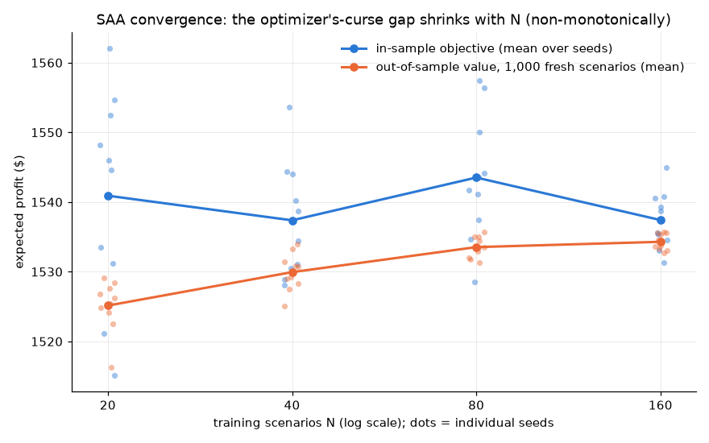

# EXPERIMENTS.md — the experiments, their committed results, and how to rerun them

Single source of truth: `reports/numbers.json`, written by

```bash
python -m experiments.build_numbers       # reruns experiments 1, 2, 3 and 5 (slow by design: each big-M solve runs out its full 120 s limit)
```

on the committed synthetic dataset (`data/synthetic/`, knobs in `SCHEMA.md`). Every
table below sits in a generated block that `python tools/render_docs.py` rewrites from
that file; no number here is typed by hand (`tests/test_readme_drift.py` checks it). The SAA experiment (§4) is heavier and has
its own committed output; `build_numbers` only summarizes it.

**Pinned settings** (`experiments/common.py`, mirrored in `numbers.json →
experiment_settings`): 24 scenarios (seed 11), main budget $1,500, no set-spend cap,
rel gap 1e-4 (the operating 0.005 would let gap noise violate the EVPI/VSS
inequalities), 120 s per-solve limit. Every solve's timing is appended to the
untracked `out/solve_log.csv`. **All results are in-sample, conditional on the pinned
scenario set** — §4 is the experiment that measures what that caveat costs.

## 1. EVPI / VSS

Rerun: `python -m experiments.evpi_vss`

RP is the two-stage optimum re-valued through the same `evaluate_plan` accounting as
every other plan (the module checks solver objective and re-valuation agree). EEV holds
the mean-scenario plan's buy units *and* price levels fixed over the full set. WS
solves each of the 24 scenarios (all of them, so it is not a subset approximation) at
the same 1e-4 rel gap setting as every experiment solve. `evpi_vss` raises if any WS
solve stops before meeting that gap; the check is newer than the committed
`numbers.json`, which records no per-scenario WS status, so for the committed run it is
unverified per scenario, and `tests/test_evpi_vss.py` re-runs the check on every CI
run. `EEV ≤ RP ≤ WS` holds up to that gap: `tests/test_evpi_vss.py` asserts each
inequality with a slack of exactly `mip_gap × max(1, |RP|)` and no more (definitions
and inequalities: `MODEL.md` §5).

<!-- generated:evpi_vss -->
| quantity (expected profit, $) | value |
| --- | --- |
| RP (two-stage stochastic optimum) | 1,568.38 |
| EEV (mean-value plan, re-valued on the scenarios) | 1,488.31 |
| WS (wait-and-see bound) | 1,673.45 |
| EVPI = WS − RP | 105.07 (6.70% of RP) |
| VSS = RP − EEV | 80.07 (5.11% of RP) |

> **Why this metric.** *Owner's question:* Is planning for uncertainty worth it, and how much could perfect forecasts add?
> *What kind of number:* Modelled, in-sample: EEV (the average-scenario plan re-valued on the scenarios) <= RP (the stochastic plan) <= WS (perfect foresight per scenario); VSS = RP - EEV and EVPI = WS - RP.
> *What would make it lie:* Both are in-sample on the pinned 24 scenarios, not out-of-sample guarantees; a solve stopped short of its gap could break the order, so a test asserts EEV <= RP <= WS within the gap.
<!-- /generated:evpi_vss -->

<!-- generated:evpi_reading -->
Reading: perfect demand foresight would be worth 6.70% of RP, and actually solving the stochastic program instead of planning on the average scenario earns 5.11% of RP. The mean-value plan fails in the usual way — the average scenario washes out the downside tail, so it overbuys exactly the units the bad scenarios cannot sell (its own solver objective, 1,669.23 on the mean scenario, is an overestimate the re-valuation corrects to 1,488.31).
<!-- /generated:evpi_reading -->

## 2. Greedy baseline vs the exact MILP

Rerun: `python -m experiments.greedy_baseline`

The greedy picks each product's best standalone price level, then buys in marginal
expected-profit-per-dollar order (min-orders enter as all-or-nothing blocks). The MILP
optimizes units and prices jointly. Same scenarios, same fee model, same level filter,
same accounting — the gap isolates the value of joint optimization. No approximation
guarantee is claimed; see "What this does NOT claim" in the README.

<!-- generated:greedy -->
| budget ($) | exact MILP ($) | greedy ($) | gap ($) | gap (% of MILP) |
| --- | --- | --- | --- | --- |
| 250.00 | 591.84 | 560.72 | 31.12 | 5.26% |
| 500.00 | 801.95 | 767.20 | 34.76 | 4.33% |
| 1,000.00 | 1,198.88 | 1,164.54 | 34.34 | 2.86% |
| 1,500.00 | 1,568.38 | 1,503.52 | 64.85 | 4.14% |
| 2,500.00 | 2,054.08 | 1,949.37 | 104.71 | 5.10% |
<!-- /generated:greedy -->

<!-- generated:greedy_range_experiments -->
Measured gap range across these 5 budgets: 2.86%–5.26%. The committed figure `docs/figs/hero.png` (the README hero) plots this table.
<!-- /generated:greedy_range_experiments -->

## 3. GDP transform: hull vs big-M

Rerun: `python -m experiments.hull_vs_bigm`

<!-- generated:bound_ratio -->
Identical instances, identical solver, rel gap 1e-4, 120 s limit. The two MILPs describe the same feasible set, so a big-M incumbent can trail but never beat the hull optimum by more than the gap allows (asserted in code with a slack of 2 × 1e-4 × |hull objective|). On this model, big-M's LP relaxation is 5.1x–13.2x looser than hull's, and big-M hits the time limit at every budget while hull reaches a plan that is optimal within a 0.01% gap in seconds:
<!-- /generated:bound_ratio -->

<!-- generated:hull_bigm -->
| budget ($) | transform | incumbent ($) | LP bound ($) | build (s) | solve (s) | result |
| --- | --- | --- | --- | --- | --- | --- |
| 500.00 | hull | 801.95 | 804.18 | 1.04 | 2.1 | optimal within a 0.01% gap |
| 500.00 | bigm | 750.30 | 10,642.59 | 0.17 | 120.6 | time limit (120 s) |
| 1,500.00 | hull | 1,568.38 | 1,572.60 | 1.31 | 3.8 | optimal within a 0.01% gap |
| 1,500.00 | bigm | 1,372.83 | 10,745.40 | 0.18 | 120.3 | time limit (120 s) |
| 2,500.00 | hull | 2,054.08 | 2,089.31 | 1.05 | 4.0 | optimal within a 0.01% gap |
| 2,500.00 | bigm | 1,896.07 | 10,745.40 | 0.17 | 120.7 | time limit (120 s) |

> **Why this metric.** *Owner's question:* Does the weekly tool solve fast enough to trust its answer?
> *What kind of number:* Counted: wall-clock seconds and termination status per solve, on identical instances with the same rel gap and a 120 s limit.
> *What would make it lie:* Timings depend on the machine and the HiGHS version (one recorded run); the result column records whether each solve reached the gap, so a timeout is never shown as optimal.
<!-- /generated:hull_bigm -->

Hull pays ~6x more build time (it adds disaggregated variables per disjunct) and earns
it back ~30–60x over in solve time — against a big-M that still had not reached
the 0.01% gap when stopped. This measured difference is why
`transform="hull"` is the default (`MODEL.md` §1; Grossmann & Trespalacios 2013).

## 4. SAA convergence (the optimizer's curse, measured)

Rerun: `python -m experiments.saa_convergence` — the heavy run (40 MILPs: 4 scenario
counts × 10 seeds, plus 1,000-scenario evaluations); it rewrites the committed
`reports/saa_convergence.csv` and `reports/saa_convergence.png`. Never run in CI.

<!-- generated:saa_shape -->
For each N ∈ {20, 40, 80, 160} and 10 fresh seeds: solve on N training scenarios, then value the chosen plan on 1,000 evaluation scenarios no training draw used. The in-sample objective systematically overstates the plan's real value — the optimizer's curse (Smith & Winkler) — and the gap shrinks as N grows, though not monotonically (N = 80's gap (9.98) sits above N = 40's (7.44) — seed noise at 10 seeds per N), which is the validation that earns the "SAA" label used in this section:
<!-- /generated:saa_shape -->



<!-- generated:saa -->
| N (training scenarios) | in-sample mean ($) | in-sample std | out-of-sample mean ($) | out-of-sample std | curse gap ($) | solve (s, mean) |
| --- | --- | --- | --- | --- | --- | --- |
| 20 | 1,540.91 | 15.15 | 1,525.14 | 3.70 | 15.77 | 3.1 |
| 40 | 1,537.38 | 8.31 | 1,529.94 | 2.70 | 7.44 | 5.4 |
| 80 | 1,543.52 | 9.15 | 1,533.53 | 1.54 | 9.98 | 10.5 |
| 160 | 1,537.42 | 4.15 | 1,534.30 | 1.19 | 3.12 | 24.0 |

> **Why this metric.** *Owner's question:* Are 24 training scenarios enough?
> *What kind of number:* Simulated: for N = 20 to 160 training scenarios, 10 seeds each, the plan's in-sample objective against its value on the 1,000 evaluation scenarios.
> *What would make it lie:* The gap shrinks with N on average but not at every step, and one seed can sit above or below the seed mean (EXPERIMENTS.md §5 prints the spread); the evaluation seed is never a training seed (test).
<!-- /generated:saa -->

<!-- generated:saa_reading -->
Reading: from N = 20 to N = 160 the out-of-sample std shrinks 3.70 → 1.19 and the curse gap shrinks 15.77 → 3.12 — non-monotonically on the way (N = 80's gap (9.98) sits above N = 40's (7.44)) — while mean solve time grows 3.1 s → 24.0 s. The pinned 24-scenario experiment set trades some of that stability for speed; §5 measures what that trade costs.
<!-- /generated:saa_reading -->

## 5. Scenario-set seed spread

Rerun: part of `python -m experiments.build_numbers` (`rp_seed_spread` in
`numbers.json`).

RP re-solved on 5 scenario sets that differ only in the generator seed, at the pinned
N=24:

<!-- generated:seed_spread -->
RP across scenario-set seeds [11, 12, 13, 14, 15]: 1,568.38, 1,523.35, 1,562.07, 1,546.05, 1,590.38
mean 1,558.05, std 25.08, spread 4.30% of the mean
<!-- /generated:seed_spread -->

<!-- generated:spread_reading -->
So a single headline RP at N = 24 carries real seed noise (max−min spread: 4.30% of the mean) — which is why the docs always name the pinned seed and label results in-sample. The pinned seed 11 sits 10.33 above the mean (0.41 sds, rank 2 of 5): a mild draw, not an outlier.
<!-- /generated:spread_reading -->

## 6. End-to-end demo numbers

Rerun: `python -m milo.demo` (same pinned settings as the e2e golden test:
24 scenarios, budget $1,500, 8 bootstrap draws, 12-scenario budget curve).

Strategy comparison on the optimal plan's buy list — fixed prices vs the optimizer's
jointly chosen prices, identical scenarios and accounting:

<!-- generated:strategies -->
| pricing strategy (same buy list) | expected ($) | p10 ($) | p90 ($) | sell-through | leftover value ($) |
| --- | --- | --- | --- | --- | --- |
| keep | 1,162.81 | 1,122.93 | 1,183.72 | 0.993 | 15.90 |
| match_market | 748.03 | 746.53 | 750.21 | 0.998 | 1.46 |
| market_minus_5 | 704.02 | 702.68 | 706.01 | 0.999 | 1.37 |
| market_plus_10 | 932.04 | 910.25 | 937.11 | 0.997 | 3.53 |
| optimal (Pyomo) | 1,492.34 | 1,382.82 | 1,584.73 | 0.966 | 70.83 |
<!-- /generated:strategies -->

<!-- generated:budget_curve -->
| budget ($) | expected profit ($) | spend ($) |
| --- | --- | --- |
| 0.00 | 345.79 | 0.00 |
| 500.00 | 812.27 | 499.57 |
| 1,500.00 | 1,497.63 | 1,497.18 |
<!-- /generated:budget_curve -->

<!-- generated:sell_through -->
Note the shape of the optimal row: it accepts a *lower* sell-through (0.966 vs 0.993) and more leftover value, because clearing every unit is not the objective — expected profit is. (The budget-curve row at $1,500 differs from the strategy-table optimum because the curve re-solves on its 12-scenario subset.)
<!-- /generated:sell_through -->

## 7. Out-of-sample scorecard (the headline)

Rerun: `python -m experiments.scorecard` (23 MILP solves, about 75 s; never in CI). It
writes `reports/scorecard.json`; `python -m experiments.scorecard --check` re-runs the
deterministic greedy list, re-values every committed plan on regenerated inputs without
solving and fails if any number is stale (`tests/test_scorecard.py` runs the same check on
every CI run); `--reuse-plans` rewrites the file from the committed plans after a code or
text change, without solving.

Three policies at six budgets, each valued in-sample (the pinned 24 scenarios, seed 11)
and out-of-sample (1,000 fresh scenarios, eval seed 999 — the SAA evaluation set, never
a training seed). Profit per restock dollar for policy p at budget B is
`(V_p(B) − V_p(0)) / spend_p(B)`, where `V_p(0)` is the same policy's own budget-0 plan
(so repricing the shelf is not credited to the buys); it is `n/a` at B = 0. The fair
baseline "today's prices, buys re-optimized" is `solve_plan` on the ratio-1.00 rows
only, so it lacks only price choice.

<!-- generated:scorecard_full -->
| budget ($) | policy | spend ($) | in-sample ($) | out-of-sample ($) | out-of-sample p10 ($) | out-of-sample p90 ($) | per restock $ (in) | per restock $ (out) | curse gap ($) |
| --- | --- | --- | --- | --- | --- | --- | --- | --- | --- |
| 0.00 | optimizer (MILP: buys + prices) | 0.00 | 343.55 | 343.25 | 345.79 | 345.79 | n/a | n/a | 0.30 |
| 0.00 | careful greedy list | 0.00 | 318.02 | 317.73 | 318.02 | 318.02 | n/a | n/a | 0.29 |
| 0.00 | today's prices, buys re-optimized | 0.00 | 298.49 | 299.00 | 299.35 | 299.35 | n/a | n/a | -0.51 |
| 250.00 | optimizer (MILP: buys + prices) | 249.77 | 591.84 | 586.00 | 536.47 | 611.24 | 0.994 | 0.972 | 5.84 |
| 250.00 | careful greedy list | 249.68 | 560.72 | 562.14 | 521.19 | 573.99 | 0.972 | 0.979 | -1.42 |
| 250.00 | today's prices, buys re-optimized | 249.73 | 496.65 | 489.28 | 447.34 | 507.77 | 0.793 | 0.762 | 7.36 |
| 500.00 | optimizer (MILP: buys + prices) | 499.66 | 801.95 | 792.71 | 730.22 | 829.04 | 0.917 | 0.900 | 9.24 |
| 500.00 | careful greedy list | 498.67 | 767.20 | 766.29 | 707.79 | 786.98 | 0.901 | 0.900 | 0.91 |
| 500.00 | today's prices, buys re-optimized | 499.94 | 651.81 | 644.37 | 600.93 | 665.61 | 0.707 | 0.691 | 7.44 |
| 1,000.00 | optimizer (MILP: buys + prices) | 999.87 | 1,198.88 | 1,188.88 | 1,123.08 | 1,225.72 | 0.855 | 0.846 | 10.00 |
| 1,000.00 | careful greedy list | 999.51 | 1,164.54 | 1,157.00 | 1,090.68 | 1,185.34 | 0.847 | 0.840 | 7.54 |
| 1,000.00 | today's prices, buys re-optimized | 1,000.00 | 933.50 | 925.09 | 882.82 | 951.24 | 0.635 | 0.626 | 8.42 |
| 1,500.00 | optimizer (MILP: buys + prices) | 1,499.79 | 1,568.38 | 1,521.36 | 1,385.26 | 1,618.54 | 0.817 | 0.786 | 47.02 |
| 1,500.00 | careful greedy list | 1,497.94 | 1,503.52 | 1,460.92 | 1,304.64 | 1,560.42 | 0.791 | 0.763 | 42.61 |
| 1,500.00 | today's prices, buys re-optimized | 1,499.90 | 1,213.23 | 1,202.58 | 1,156.10 | 1,231.51 | 0.610 | 0.602 | 10.66 |
| 2,500.00 | optimizer (MILP: buys + prices) | 2,499.76 | 2,054.08 | 2,013.74 | 1,816.14 | 2,177.67 | 0.684 | 0.668 | 40.34 |
| 2,500.00 | careful greedy list | 2,497.88 | 1,949.37 | 1,889.16 | 1,692.61 | 2,054.71 | 0.653 | 0.629 | 60.20 |
| 2,500.00 | today's prices, buys re-optimized | 2,499.49 | 1,628.63 | 1,603.12 | 1,477.31 | 1,718.50 | 0.532 | 0.522 | 25.51 |

Paired leads (every plan is valued on the same evaluation scenarios, so the per-scenario differences are paired):

| budget ($) | optimizer − greedy, out-of-sample ($) | paired SE ($) | paired SE of the per-dollar lift | optimizer − today's prices ($) | paired SE ($) |
| --- | --- | --- | --- | --- | --- |
| 0.00 | 25.52 | 0.24 | n/a | 44.24 | 0.23 |
| 250.00 | 23.86 | 0.69 | 0.002 | 96.71 | 0.50 |
| 500.00 | 26.42 | 0.70 | 0.001 | 148.34 | 0.71 |
| 1,000.00 | 31.88 | 0.90 | 0.001 | 263.79 | 0.79 |
| 1,500.00 | 60.45 | 1.30 | 0.001 | 318.78 | 2.48 |
| 2,500.00 | 124.57 | 3.02 | 0.001 | 410.62 | 4.14 |

> **Why this metric.** *Owner's question:* How much does the in-sample number flatter itself?
> *What kind of number:* Simulated: in-sample objective on the 24 training scenarios minus the same plan's value on the 1,000 evaluation scenarios.
> *What would make it lie:* Out-of-sample has no sign guarantee, so the gap is reported, never asserted; with 24 scenarios seed noise is large (EXPERIMENTS.md §5).
<!-- /generated:scorecard_full -->

Out-of-sample values carry no sign guarantee, so they are reported, never asserted.
The losses, as printed:

<!-- generated:oos_losses -->
- At $250 the greedy list returns 0.979 per restock dollar out of sample vs the optimizer's 0.972; the optimizer's total profit is higher (586.00 vs 562.14); the two budget-0 bases are 343.25 vs 317.73.
<!-- /generated:oos_losses -->

**Marginal value of a budget dollar** (the optimizer, re-solved at B − 50 and B + 50):

<!-- generated:marginal -->
| budget B ($) | next dollar, in-sample | next dollar, out-of-sample | average dollar, in-sample | gap noise per dollar |
| --- | --- | --- | --- | --- |
| 250.00 | 0.884 | 0.845 | 0.994 | ±0.0013 |
| 500.00 | 0.799 | 0.792 | 0.917 | ±0.0017 |
| 1,000.00 | 0.791 | 0.765 | 0.855 | ±0.0025 |
| 1,500.00 | 0.652 | 0.633 | 0.817 | ±0.0032 |
| 2,500.00 | 0.519 | 0.544 | 0.684 | ±0.0042 |

> **Why this metric.** *Owner's question:* Should I put in more cash?
> *What kind of number:* Modelled: (obj(B + 50) - obj(B - 50)) / 100, from two re-solves; the average return hides the last dollar.
> *What would make it lie:* Each solve may stop up to mip_gap x |bound| from the optimum, so the slope carries that much noise; the tolerance is printed beside it and budget monotonicity is tested.
<!-- /generated:marginal -->

**Fee-blind (textbook) plan**:

<!-- generated:fee_blind -->
A fee-blind (textbook) plan at $1,500 promises 2,068.54 but earns 1,562.89 at the true fees in-sample (1,523.71 out-of-sample): it overstates its profit by 505.65 while the fee-aware optimum earns 1,568.38. Its stocked products that sit on a price level the true fees would drop: 0. Out of sample the fee-blind plan earns 2.35 more than the fee-aware plan (1,523.71 vs 1,521.36, paired SE 0.63): more than two paired SEs, so on the model's own generator modelling fees is a small loss out of sample, not a gain; the null is that the decisions barely move, in either direction.

> **Why this metric.** *Owner's question:* What does ignoring the store's cut overstate?
> *What kind of number:* Modelled: a plan solved on list prices (no commission, card or order fees), then valued at the true fees.
> *What would make it lie:* Its own objective must be >= its value at true fees, in total (test); if fees were close to proportional the plan would barely change, and that null ships as printed.
<!-- /generated:fee_blind -->

## 8. The constraint ladder (from textbook to business)

Rerun: `python -m experiments.constraint_ladder` (19 MILP solves plus one LP relaxation, about 95 s; never in CI).
It writes `reports/constraint_ladder.json` (its own file, so `numbers.json` and the
goldens stay frozen); `--check` re-values the committed plans, recounts shelf use,
price edits and grid-edge moves independently from the plan (the edge recount must agree
with the solver's M2 flag), re-runs every logic check and fails on any stale number;
`--reuse-plans` rewrites the file from the committed plans without solving.

Rules attach to the GDP model before the hull transform (`milo/ladder.py`,
`solve_with_rules`); with every rule off the model is identical to `solve_plan`'s (same
variable and constraint counts, tested). Each rung is typed by kind and gets the test
that fits it: a **restriction** must not raise profit (`obj ≤ previous + mip_gap ×
|bound|`); an **accounting** rung must be worth ≥ 0 against the previous plan re-valued
under the new accounting (the VSS logic). Shelf space per product type is illustrative
(`milo/ladder.py` `SPACE_BY_TYPE`, `MODEL.md` §7) and the capacity is swept, never
taken from a store.

<!-- generated:ladder -->
| rung | rule added | kind | expected profit ($) | vs previous rung ($) | binds? | prices changed | shelf used | worst-10% profit ($) | out-of-sample ($) | solve (s) | reached the gap |
| --- | --- | --- | --- | --- | --- | --- | --- | --- | --- | --- | --- |
| R0a | textbook: list price, no fees | accounting | 1,562.89 | n/a | n/a | 15 | 378.0 | 1,488.77 | 1,523.71 | 3.6 | yes, 0.01% |
| R0b | + store commission, card fee, per-order fee (today) | accounting | 1,568.38 | +5.49 (value of modeling it) | n/a | 15 | 378.5 | 1,505.56 | 1,521.36 | 3.6 | yes, 0.01% |
| R1 | + shelf space (70% of today's plan's use) | restriction | 1,325.20 | −243.18 (price of the rule) | yes | 14 | 264.5 | 1,137.82 | 1,327.48 | 3.0 | yes, 0.01% |
| R2 | + weekly price-edit limit (P = 4) | restriction | 1,258.64 | −66.55 (price of the rule) | yes | 4 | 264.5 | 1,065.41 | 1,264.94 | 3.8 | yes, 0.01% |

> **Why this metric.** *Owner's question:* Which business rule costs the most, so which one to relax first?
> *What kind of number:* Modelled, in-sample: obj(looser rung) - obj(this rung) for a restriction; for an accounting rung, obj(new plan) - value(old plan under the new accounting).
> *What would make it lie:* Only true restrictions get the can't-raise-profit test (tolerance mip_gap x |bound|); an accounting rung gets the VSS-style test instead, and every rung records whether it solved to the gap.
<!-- /generated:ladder -->

Each rule alone against today's model, and the price of the rules the model already had:

<!-- generated:ladder_alone -->
| rung | rule, alone against today's model | expected profit ($) | price of the rule ($, % of RP) | out-of-sample ($) | solve (s) |
| --- | --- | --- | --- | --- | --- |
| R1 | shelf space alone (70%) | 1,325.20 | 243.18 (15.51%) | 1,327.48 | 3.0 |
| R2 | price-edit limit alone (P = 4) | 1,464.34 | 104.03 (6.63%) | 1,423.09 | 8.1 |
| existing | 35% per-set spend cap | n/a | 74.25 (4.73%) | n/a | n/a |
| existing | all-or-nothing minimum order | n/a | 0.00 (0.00%); the rule binds on 1 of 17 products, which neither plan buys, so its 0.00 is close to vacuous, not a measured null | n/a | n/a |
| existing | integrality (LP relaxation: integer units and every disjunct binary relaxed) | n/a | 4.22 (0.27%) | n/a | n/a |
<!-- /generated:ladder_alone -->

**R1 shelf sweep** (capacity as a share of today's plan's shelf use; "value of 1 more
space unit" is a re-solve with 5 more units, divided by 5 — what renting more shelf is
worth over the 8-week horizon):

<!-- generated:shelf_sweep -->
| shelf V (% of today's plan's use) | V (pack-equivalents) | used | expected profit ($) | price of the rule ($) | value of 1 more space unit ($) | out-of-sample ($) | units bought by type |
| --- | --- | --- | --- | --- | --- | --- | --- |
| 50% | 189.25 | 189.0 | 1,100.82 | 467.56 | 3.40 ±0.04 | 1,104.78 | booster_box 6, booster_bundle 1, collection 1, etb 2, single 59, tin 3 |
| 70% | 264.95 | 264.5 | 1,325.20 | 243.18 | 1.53 ±0.05 | 1,327.48 | booster_box 6, booster_pack 4, collection 1, etb 14, single 42 |
| 90% | 340.65 | 340.5 | 1,528.16 | 40.21 | 2.14 ±0.06 | 1,492.26 | booster_bundle 3, booster_pack 37, collection 2, etb 24, single 52, tin 3 |
| 100% | 378.50 | 378.5 | 1,568.38 | 0.00 | 0.00 ±0.06 | 1,521.36 | booster_bundle 3, booster_pack 71, collection 3, etb 26, single 32, tin 1 |

**Rent-more-shelf rule:** rent one more space unit only if it costs less than its value over the 8-week horizon: 3.40 at 50%, 1.53 at 70%, 2.14 at 90%. At 100% one more unit is worth 0.00, inside its ±0.06 solver noise, so renting more never pays.

> **Why this metric.** *Owner's question:* If I rent more shelf, what is one more unit of space worth?
> *What kind of number:* Modelled, in-sample: shelf capacity swept at 50/70/90/100% of today's plan's use, with illustrative space per product type; the slope is a re-solve with 5 more units.
> *What would make it lie:* Space values are made up and swept, not measured; shelf use is recounted independently from the plan (test) and must be <= capacity, and on-hand stock over capacity raises a SHELF flag.
<!-- /generated:shelf_sweep -->

The value of more shelf is lumpy, not smooth: whether 5 more units fit one more large
box changes the slope, so it need not fall as the shelf grows.

**R2 price-edit sweep** (the "price of simplicity": at most P stocked products moved off
today's price):

<!-- generated:edit_sweep -->
| edit limit P | edits used | expected profit ($) | price of the rule ($) | out-of-sample ($) | solve (s) |
| --- | --- | --- | --- | --- | --- |
| 0 | 0 | 1,213.23 | 355.14 | 1,202.58 | 0.5 |
| 1 | 1 | 1,380.17 | 188.21 | 1,338.05 | 3.4 |
| 2 | 2 | 1,413.34 | 155.04 | 1,371.69 | 5.0 |
| 4 | 4 | 1,464.34 | 104.03 | 1,423.09 | 8.1 |
| 8 | 8 | 1,527.51 | 40.87 | 1,489.51 | 9.0 |
| all (17) | 15 | 1,568.38 | 0.00 | 1,521.36 | 3.6 |

> **Why this metric.** *Owner's question:* How many relabels a week are worth the staff time?
> *What kind of number:* Modelled, in-sample: profit with at most P stocked products moved off today's price, P = 0, 1, 2, 4, 8, all.
> *What would make it lie:* Edits are recounted independently from the plan (stocked and ratio != 1.00) and must be <= P; an unstocked product never counts, and P = 0 must leave every stocked product at 1.00.
<!-- /generated:edit_sweep -->

P = 0 is the same plan as the scorecard's fair baseline (today's prices, buys
re-optimized); a test checks the two agree within the gap.
