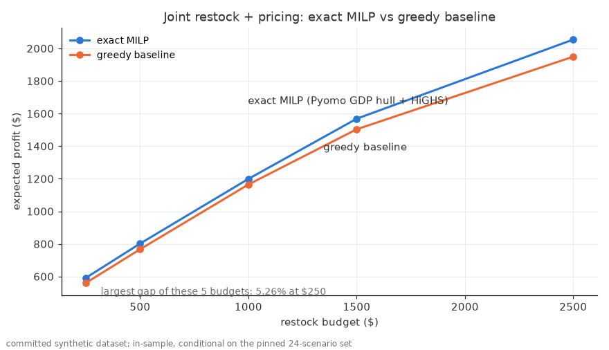

# milo

Two-stage stochastic restock + pricing optimizer for a card shop — Pyomo GDP → HiGHS, with demand shrinkage, kinked elasticities, and honest EVPI/VSS experiments.

[](https://github.com/chasebak/milo/actions/workflows/ci.yml)

<!-- generated:headline -->
**Out-of-sample profit per restock dollar at $1,500: optimizer 0.786 vs the careful greedy list 0.763** (today's prices with the buys re-optimized: 0.602), on 1,000 fresh scenarios from the model's own generator (synthetic). In-sample the same plans claim 0.817 vs 0.791; the optimizer's in-sample profit 1,568.38 falls to 1,521.36 out of sample, an optimizer's-curse gap of 47.02 (3.00%).
<!-- /generated:headline -->

<!-- generated:try_it -->
**Try it (60 s): the Restock Explorer page** in `docs/` (not published yet; serve it locally with `python -m http.server -d docs` and open the address it prints). One budget slider, which snaps to 36 solved budgets from $0 to $3,000, moves the out-of-sample profit-per-dollar tiles, the profit curve and the buy list together; the EEV → RP → WS bracket and the scenario-count check sit below. Budgets between the solved points were never solved, so the slider snaps instead of interpolating. The page computes nothing: `python -m experiments.viz build` writes its data and `tests/test_viz.py` checks it.
<!-- /generated:try_it -->

## KPIs

Every value below is computed by this repo's tested code into a committed file and rendered here by `python tools/render_docs.py`; `tests/test_readme_drift.py` fails if any README number drifts from those files. All data is synthetic.

<!-- generated:kpi_table -->
| KPI | formula | why it matters | compared against | what the software does to it | measured on | value now |
| --- | --- | --- | --- | --- | --- | --- |
| Profit per restock dollar, out-of-sample (headline) | (E[profit at B] - E[profit of the same policy's budget-0 plan]) / spend at B, on 1,000 fresh scenarios (eval seed 999); n/a at B = 0 | What each dollar tied up in stock returns; fresh scenarios stop the plan grading itself | the careful greedy list; today's prices with the buys re-optimized | raises it | out-of-sample on the model's own generator | 0.786 vs 0.763 greedy, 0.602 today's prices, at $1,500 (`reports/scorecard.json` → `headline`) |
| Optimizer's-curse gap | in-sample objective - out-of-sample value of the same plan | How much the in-sample headline flatters itself | the SAA table (EXPERIMENTS.md §4) | reported, not hidden | out-of-sample on the model's own generator | 47.02 (3.00%) at $1,500 (`reports/scorecard.json` → `headline.curse_gap`) |
| Marginal value of a budget dollar | (obj(B + 50) - obj(B - 50)) / 100 | "Should I put in more cash?" The average hides the last dollar | the average return at B (in-sample profit per restock dollar) | shows where to stop adding budget | synthetic, in-sample (modelled on the 24 training scenarios, not truth) | 0.652 per dollar at $1,500 vs average 0.817 (`reports/scorecard.json` → `marginal`) |
| Price of each business rule | obj(previous rung) - obj(this rung), in $ and % of RP | Which rule to relax first | the rung before | measured per rung | synthetic, in-sample (modelled on the 24 training scenarios, not truth) | R1 243.18 (15.51%); R2 66.55 (4.24%) (`reports/constraint_ladder.json` → `derived.ladder`) |
| Solve time within a 0.01% gap | wall-clock seconds and termination status per solve (rel gap 1e-4, 120 s limit) | A weekly tool must solve fast enough to trust its answer | big-M on identical instances | hull reaches the gap; big-M times out | synthetic truth (counted on one machine) | hull 3 of 3 reach the gap in 2.1–4.0 s; big-M 0 of 3 within the 120 s limit (`reports/numbers.json` → `hull_vs_bigm`); the page grid's 72 hull solves: 72 reach the gap, 0.1–9.9 s (`docs/data/method.json` → `grid_facts`) |
<!-- /generated:kpi_table -->

**Guarantees (tests), kept apart from the KPIs:**

- The greedy list and the today's-prices baseline never beat the exact MILP in-sample, within `mip_gap × |bound|` (`tests/test_scorecard.py`).
- More budget never lowers the optimizer's in-sample profit, within the gap; spend never exceeds the budget.
- The evaluation seed (999) is never a training seed; profit per restock dollar recomputes as `(value − base) / spend` and is `n/a` at B = 0.
- Every restriction rung (shelf, price edits, set cap, min order, integrality) can't raise profit, within `mip_gap × |bound|`; the accounting rung (fees) is worth ≥ 0 (`tests/test_ladder.py`, with exact checks at `mip_gap = 0` on small cases and controls that must fail).
- Shelf use and price edits are recounted independently from the plan (tests) and never exceed their limits; `P = 0` leaves every stocked product at today's price.
- The grid-edge recount (`ladder.grid_edge_moves`) agrees with the solver's M2 flag on every ladder solve, and the today's-prices baseline refuses to run if any product's ratio-1.00 level fails the M1 filter (`tests/test_ladder.py`, `tests/test_scorecard.py`).
- `EEV ≤ RP ≤ WS` within the gap (`tests/test_evpi_vss.py`).

<!-- generated:hero -->

<!-- /generated:hero -->

## Quickstart

```bash
git clone https://github.com/chasebak/milo && cd milo
python3.12 -m venv .venv && source .venv/bin/activate  # needs Python >= 3.12
pip install -r requirements-ci.txt && pip install -e .
python -m pytest -q
python -m milo.demo
```

Supported platforms: macOS arm64 and Linux (CI runs Ubuntu, Python 3.12–3.13; `highspy` ships wheels for both). The demo runs the whole pipeline on the committed synthetic dataset at `data/synthetic/` (schema in `SCHEMA.md`; no real store data is included), finishes in well under 90 s, and writes only to the untracked `out/`.

The demo ends with this table — the optimizer's buy list priced by fixed rules vs its own jointly chosen prices (rendered from the committed `reports/numbers.json` by `python tools/render_docs.py`; rerun `python -m milo.demo` to reproduce it). Its "keep" row holds the optimizer's buys at today's prices, a straw man kept for context; the fair today's-prices baseline re-optimizes the buys (see the scorecard below):

<!-- generated:strategies -->
| pricing strategy (same buy list) | expected ($) | p10 ($) | p90 ($) | sell-through | leftover value ($) |
| --- | --- | --- | --- | --- | --- |
| keep | 1,162.81 | 1,122.93 | 1,183.72 | 0.993 | 15.90 |
| match_market | 748.03 | 746.53 | 750.21 | 0.998 | 1.46 |
| market_minus_5 | 704.02 | 702.68 | 706.01 | 0.999 | 1.37 |
| market_plus_10 | 932.04 | 910.25 | 937.11 | 0.997 | 3.53 |
| optimal (Pyomo) | 1,492.34 | 1,382.82 | 1,584.73 | 0.966 | 70.83 |
<!-- /generated:strategies -->

## What it decides

From the store's stock history, a licensed third-party market-data feed, and a hand-edited cost sheet, it picks — for every product the primary seller carries — **how many units to buy** (integer, with an all-or-nothing minimum order) and **one price level** from a 0.80×–1.15× grid around today's price, to maximize expected profit under a restock budget and an optional per-set spend cap. The *primary seller* is the one configured seller whose restock budget the plan spends (`primary_seller` in `milo/config.py`); the other sellers' sales enter only as demand evidence, never as buy decisions.

## The model in 8 lines

1. Stage 1 (here-and-now): integer buy units `x_i` and exactly one price level per product, written as a Pyomo GDP — an XOR price disjunction plus an order/no-order disjunction (`min_order ≤ x_i ≤ max_units` or `x_i = 0`).
2. Stage 2, per scenario ω: sales are capped at demand, `s_iω = min(D_ikω, on_hand_i + x_i)`; leftovers are salvaged at `salvage_frac_i × cost_i`. There are no recourse decisions.
3. Objective: expected net revenue plus salvage, minus buy cost; net cash per unit comes from the fee model (store commission + card fee on the card-paid share + a flat per-order fee).
4. Demand `D_ikω`: a gamma-Poisson posterior predictive (empirical-Bayes shrinkage toward the product type) times a kinked price-response curve `h(m)`, crossed with a three-point elasticity grid.
5. One shared uniform per (unit, scenario) drives every price level through the Poisson inverse CDF, so demand never rises with price.
6. Ordinary constraints: budget, optional per-set spend cap, per-product `max_units`.
7. The GDP becomes a MILP via `gdp.hull` (default; `gdp.bigm` kept for comparison) and HiGHS solves it.
8. Anything the solver had to do silently becomes a flag on the result (`M1`–`M10` in `MODEL.md`), never a silent edit.

## Results (committed synthetic dataset)

Every number below is computed by this repo's code on the committed synthetic dataset and rendered from the committed reports by `python tools/render_docs.py`: `reports/scorecard.json` (`python -m experiments.scorecard`), `reports/constraint_ladder.json` (`python -m experiments.constraint_ladder`) and `reports/numbers.json` (`python -m experiments.build_numbers`). "In-sample" means the pinned 24-scenario set (seed 11); "out-of-sample" means 1,000 fresh scenarios (eval seed 999) from the model's own generator, not a real store. The dataset knobs were chosen so the stochastic effects are visible — see `SCHEMA.md`. Each choice behind these numbers, with what it beat and by how much, is in `DECISIONS.md`; every knob and its source is in `MODEL.md` §7.

### Out-of-sample scorecard (leads, even though it is lower)

<!-- generated:scorecard_headline -->
| policy (budget $1,500) | spend ($) | in-sample profit ($) | out-of-sample profit ($) | profit per restock $ (in) | profit per restock $ (out) | curse gap ($) |
| --- | --- | --- | --- | --- | --- | --- |
| optimizer (MILP: buys + prices) | 1,499.79 | 1,568.38 | 1,521.36 | 0.817 | 0.786 | 47.02 |
| careful greedy list | 1,497.94 | 1,503.52 | 1,460.92 | 0.791 | 0.763 | 42.61 |
| today's prices, buys re-optimized | 1,499.90 | 1,213.23 | 1,202.58 | 0.610 | 0.602 | 10.66 |

Paired on the same 1,000 evaluation scenarios, the optimizer leads the greedy list by 60.45 out-of-sample profit (paired SE 1.30) and by 0.022 per restock dollar (paired SE 0.001); it leads today's prices by 318.78 (paired SE 2.48). The SEs cover evaluation-set sampling only, not model error.

> **Why this metric.** *Owner's question:* What does each restock dollar return, on demand the plan never saw?
> *What kind of number:* Simulated: each policy's plan is valued on 1,000 fresh scenarios (eval seed 999) from the model's own demand generator, minus the same policy's budget-0 plan, divided by what it spent.
> *What would make it lie:* It flatters the optimizer if the evaluation set leaks into training (test: eval seed 999 is never a training seed) and it is only as true as the generator, so it is out-of-sample on the model's own generator, not on a real store.

> **Why this metric.** *Owner's question:* Is the lift just repricing, or does planning the buys matter too?
> *What kind of number:* Modelled: today's prices held fixed (ratio 1.00) while the buys are re-optimized by the same MILP, so the only thing it lacks is price choice.
> *What would make it lie:* A same-buys-at-today's-prices row would be a straw man; this row re-optimizes the buys (test: it equals the price-edit limit P = 0 rung within the gap).
<!-- /generated:scorecard_headline -->

<!-- generated:edge_note -->
**The price grid binds.** At $1,500, 15 of the optimizer's 15 price moves sit at the 1.15× grid edge (flag M2): the grid, not the data, binds, and the true optimum likely lies above it. Optimizer moves at the edge by budget: 7 of 7 at $0, 10 of 10 at $250, 12 of 12 at $500, 13 of 13 at $1,000, 15 of 15 at $1,500, 17 of 17 at $2,500; the greedy list: 5 of 7, 9 of 11, 10 of 12, 10 of 12, 11 of 14, 11 of 15; the ladder's solves raise M2 in 18 of 19. So the lead over today's prices (0.786 vs 0.602 per restock dollar) and the cost of the P = 0 price-edit rung measure the 0.80–1.15× grid as much as the data.
<!-- /generated:edge_note -->

Out of sample has no sign guarantee, so the losses are printed, not hidden:

<!-- generated:oos_losses -->
- At $250 the greedy list returns 0.979 per restock dollar out of sample vs the optimizer's 0.972; the optimizer's total profit is higher (586.00 vs 562.14); the two budget-0 bases are 343.25 vs 317.73.
<!-- /generated:oos_losses -->

The last budget dollar returns less than the average one:

<!-- generated:marginal -->
| budget B ($) | next dollar, in-sample | next dollar, out-of-sample | average dollar, in-sample | gap noise per dollar |
| --- | --- | --- | --- | --- |
| 250.00 | 0.884 | 0.845 | 0.994 | ±0.0013 |
| 500.00 | 0.799 | 0.792 | 0.917 | ±0.0017 |
| 1,000.00 | 0.791 | 0.765 | 0.855 | ±0.0025 |
| 1,500.00 | 0.652 | 0.633 | 0.817 | ±0.0032 |
| 2,500.00 | 0.519 | 0.544 | 0.684 | ±0.0042 |

> **Why this metric.** *Owner's question:* Should I put in more cash?
> *What kind of number:* Modelled: (obj(B + 50) - obj(B - 50)) / 100, from two re-solves; the average return hides the last dollar.
> *What would make it lie:* Each solve may stop up to mip_gap x |bound| from the optimum, so the slope carries that much noise; the tolerance is printed beside it and budget monotonicity is tested.
<!-- /generated:marginal -->

All five budgets, with p10/p90, are in `EXPERIMENTS.md` §7.

### Method checks (in-sample, budget $1,500)

<!-- generated:evpi_vss -->
| quantity (expected profit, $) | value |
| --- | --- |
| RP (two-stage stochastic optimum) | 1,568.38 |
| EEV (mean-value plan, re-valued on the scenarios) | 1,488.31 |
| WS (wait-and-see bound) | 1,673.45 |
| EVPI = WS − RP | 105.07 (6.70% of RP) |
| VSS = RP − EEV | 80.07 (5.11% of RP) |

> **Why this metric.** *Owner's question:* Is planning for uncertainty worth it, and how much could perfect forecasts add?
> *What kind of number:* Modelled, in-sample: EEV (the average-scenario plan re-valued on the scenarios) <= RP (the stochastic plan) <= WS (perfect foresight per scenario); VSS = RP - EEV and EVPI = WS - RP.
> *What would make it lie:* Both are in-sample on the pinned 24 scenarios, not out-of-sample guarantees; a solve stopped short of its gap could break the order, so a test asserts EEV <= RP <= WS within the gap.
<!-- /generated:evpi_vss -->

<!-- generated:greedy_range -->
Across the 5 budgets of the greedy experiment ($250–$2,500), a budget-greedy baseline trails the exact MILP in-sample by 2.86%–5.26%; the hero figure above is that comparison. On the page's 36-budget grid the optimizer's widest in-sample lead over the careful greedy list is 7.10% at $2,700.
<!-- /generated:greedy_range -->

The full experiment suite — EVPI/VSS, greedy gap, hull vs big-M, scenario-count convergence, seed spread, the scorecard and the constraint ladder — lives in `EXPERIMENTS.md`; the formulation, estimation details, assumptions and flag vocabulary live in `MODEL.md`. The executed walkthrough notebook `pricing_optimizer.ipynb` is regenerated by `python tools/build_notebook.py` (CI does not execute it).

## From textbook to business: the constraint ladder

The base model is the textbook price-setting newsvendor made stochastic. Each rung adds one rule a real consignment shelf lives with, easiest first, and the table reports what that rule costs in expected profit and solve time. Restriction rungs can only lower profit (a test checks it); accounting rungs change how money is counted, so they report what modeling the rule is worth, the way VSS does. Shelf space per product type is illustrative and the capacity is swept as a share of today's plan's use, never taken from a store. Values are in-sample on the pinned 24-scenario set unless a column says out-of-sample.

<!-- generated:ladder -->
| rung | rule added | kind | expected profit ($) | vs previous rung ($) | binds? | prices changed | shelf used | worst-10% profit ($) | out-of-sample ($) | solve (s) | reached the gap |
| --- | --- | --- | --- | --- | --- | --- | --- | --- | --- | --- | --- |
| R0a | textbook: list price, no fees | accounting | 1,562.89 | n/a | n/a | 15 | 378.0 | 1,488.77 | 1,523.71 | 3.6 | yes, 0.01% |
| R0b | + store commission, card fee, per-order fee (today) | accounting | 1,568.38 | +5.49 (value of modeling it) | n/a | 15 | 378.5 | 1,505.56 | 1,521.36 | 3.6 | yes, 0.01% |
| R1 | + shelf space (70% of today's plan's use) | restriction | 1,325.20 | −243.18 (price of the rule) | yes | 14 | 264.5 | 1,137.82 | 1,327.48 | 3.0 | yes, 0.01% |
| R2 | + weekly price-edit limit (P = 4) | restriction | 1,258.64 | −66.55 (price of the rule) | yes | 4 | 264.5 | 1,065.41 | 1,264.94 | 3.8 | yes, 0.01% |

> **Why this metric.** *Owner's question:* Which business rule costs the most, so which one to relax first?
> *What kind of number:* Modelled, in-sample: obj(looser rung) - obj(this rung) for a restriction; for an accounting rung, obj(new plan) - value(old plan under the new accounting).
> *What would make it lie:* Only true restrictions get the can't-raise-profit test (tolerance mip_gap x |bound|); an accounting rung gets the VSS-style test instead, and every rung records whether it solved to the gap.
<!-- /generated:ladder -->

Each rule alone against today's model, plus the rules the model already had:

<!-- generated:ladder_alone -->
| rung | rule, alone against today's model | expected profit ($) | price of the rule ($, % of RP) | out-of-sample ($) | solve (s) |
| --- | --- | --- | --- | --- | --- |
| R1 | shelf space alone (70%) | 1,325.20 | 243.18 (15.51%) | 1,327.48 | 3.0 |
| R2 | price-edit limit alone (P = 4) | 1,464.34 | 104.03 (6.63%) | 1,423.09 | 8.1 |
| existing | 35% per-set spend cap | n/a | 74.25 (4.73%) | n/a | n/a |
| existing | all-or-nothing minimum order | n/a | 0.00 (0.00%); the rule binds on 1 of 17 products, which neither plan buys, so its 0.00 is close to vacuous, not a measured null | n/a | n/a |
| existing | integrality (LP relaxation: integer units and every disjunct binary relaxed) | n/a | 4.22 (0.27%) | n/a | n/a |
<!-- /generated:ladder_alone -->

<!-- generated:fee_blind -->
A fee-blind (textbook) plan at $1,500 promises 2,068.54 but earns 1,562.89 at the true fees in-sample (1,523.71 out-of-sample): it overstates its profit by 505.65 while the fee-aware optimum earns 1,568.38. Its stocked products that sit on a price level the true fees would drop: 0. Out of sample the fee-blind plan earns 2.35 more than the fee-aware plan (1,523.71 vs 1,521.36, paired SE 0.63): more than two paired SEs, so on the model's own generator modelling fees is a small loss out of sample, not a gain; the null is that the decisions barely move, in either direction.

> **Why this metric.** *Owner's question:* What does ignoring the store's cut overstate?
> *What kind of number:* Modelled: a plan solved on list prices (no commission, card or order fees), then valued at the true fees.
> *What would make it lie:* Its own objective must be >= its value at true fees, in total (test); if fees were close to proportional the plan would barely change, and that null ships as printed.
<!-- /generated:fee_blind -->

Shelf sweep and the "price of simplicity" curve (profit vs allowed price edits):

<!-- generated:shelf_sweep -->
| shelf V (% of today's plan's use) | V (pack-equivalents) | used | expected profit ($) | price of the rule ($) | value of 1 more space unit ($) | out-of-sample ($) | units bought by type |
| --- | --- | --- | --- | --- | --- | --- | --- |
| 50% | 189.25 | 189.0 | 1,100.82 | 467.56 | 3.40 ±0.04 | 1,104.78 | booster_box 6, booster_bundle 1, collection 1, etb 2, single 59, tin 3 |
| 70% | 264.95 | 264.5 | 1,325.20 | 243.18 | 1.53 ±0.05 | 1,327.48 | booster_box 6, booster_pack 4, collection 1, etb 14, single 42 |
| 90% | 340.65 | 340.5 | 1,528.16 | 40.21 | 2.14 ±0.06 | 1,492.26 | booster_bundle 3, booster_pack 37, collection 2, etb 24, single 52, tin 3 |
| 100% | 378.50 | 378.5 | 1,568.38 | 0.00 | 0.00 ±0.06 | 1,521.36 | booster_bundle 3, booster_pack 71, collection 3, etb 26, single 32, tin 1 |

**Rent-more-shelf rule:** rent one more space unit only if it costs less than its value over the 8-week horizon: 3.40 at 50%, 1.53 at 70%, 2.14 at 90%. At 100% one more unit is worth 0.00, inside its ±0.06 solver noise, so renting more never pays.

> **Why this metric.** *Owner's question:* If I rent more shelf, what is one more unit of space worth?
> *What kind of number:* Modelled, in-sample: shelf capacity swept at 50/70/90/100% of today's plan's use, with illustrative space per product type; the slope is a re-solve with 5 more units.
> *What would make it lie:* Space values are made up and swept, not measured; shelf use is recounted independently from the plan (test) and must be <= capacity, and on-hand stock over capacity raises a SHELF flag.
<!-- /generated:shelf_sweep -->

<!-- generated:edit_sweep -->
| edit limit P | edits used | expected profit ($) | price of the rule ($) | out-of-sample ($) | solve (s) |
| --- | --- | --- | --- | --- | --- |
| 0 | 0 | 1,213.23 | 355.14 | 1,202.58 | 0.5 |
| 1 | 1 | 1,380.17 | 188.21 | 1,338.05 | 3.4 |
| 2 | 2 | 1,413.34 | 155.04 | 1,371.69 | 5.0 |
| 4 | 4 | 1,464.34 | 104.03 | 1,423.09 | 8.1 |
| 8 | 8 | 1,527.51 | 40.87 | 1,489.51 | 9.0 |
| all (17) | 15 | 1,568.38 | 0.00 | 1,521.36 | 3.6 |

> **Why this metric.** *Owner's question:* How many relabels a week are worth the staff time?
> *What kind of number:* Modelled, in-sample: profit with at most P stocked products moved off today's price, P = 0, 1, 2, 4, 8, all.
> *What would make it lie:* Edits are recounted independently from the plan (stocked and ratio != 1.00) and must be <= P; an unstocked product never counts, and P = 0 must leave every stocked product at 1.00.
<!-- /generated:edit_sweep -->

## Design decisions / what didn't work

<!-- generated:hull_lead -->
- **Hull, not big-M.** The GDP-to-MILP transform is the difference between solving and not solving this model. With identical instances and a 1e-4 rel gap, hull reaches a plan that is optimal within a 0.01% gap in seconds while big-M hits the 120 s limit at every budget with a 5.1x–13.2x looser LP bound:
<!-- /generated:hull_lead -->

<!-- generated:hull_bigm -->
| budget ($) | transform | incumbent ($) | LP bound ($) | build (s) | solve (s) | result |
| --- | --- | --- | --- | --- | --- | --- |
| 500.00 | hull | 801.95 | 804.18 | 1.04 | 2.1 | optimal within a 0.01% gap |
| 500.00 | bigm | 750.30 | 10,642.59 | 0.17 | 120.6 | time limit (120 s) |
| 1,500.00 | hull | 1,568.38 | 1,572.60 | 1.31 | 3.8 | optimal within a 0.01% gap |
| 1,500.00 | bigm | 1,372.83 | 10,745.40 | 0.18 | 120.3 | time limit (120 s) |
| 2,500.00 | hull | 2,054.08 | 2,089.31 | 1.05 | 4.0 | optimal within a 0.01% gap |
| 2,500.00 | bigm | 1,896.07 | 10,745.40 | 0.17 | 120.7 | time limit (120 s) |

> **Why this metric.** *Owner's question:* Does the weekly tool solve fast enough to trust its answer?
> *What kind of number:* Counted: wall-clock seconds and termination status per solve, on identical instances with the same rel gap and a 120 s limit.
> *What would make it lie:* Timings depend on the machine and the HiGHS version (one recorded run); the result column records whether each solve reached the gap, so a timeout is never shown as optimal.
<!-- /generated:hull_bigm -->

- **The silent `Order paid by` fallback, made loud.** The commission-workbook loader defaults missing payment types to "Card" (the workbook's own convention for weeks before the column existed). An earlier version let a *misspelled* header fall into the same default, silently corrupting the card-fee share. The exact-header requirement is now documented in `SCHEMA.md`, and a contract test fails when the column is absorbed (the card share would read 1.0).
- **Template-write side effect removed.** `pipeline.run` used to write the cost template into the dataset directory on every run — a data directory that mutates when you *read* it. Now `write_cost_template` only runs when a path is passed explicitly and never overwrites an existing file; the demo and tests never write into `data/`.
- **Seller registry instead of hardcoded sellers.** Seller names, file names and title grammars were scattered through the loaders. They now live in one `SellerConfig` registry in `milo/config.py` (id, display name, title grammar, sales file), so nothing downstream hardcodes a seller.

## What this does NOT claim

- For a fixed price level, expected sales revenue has diminishing returns in order quantity (DR-submodular on the integer lattice), which motivates the greedy; the full problem is non-monotone with knapsack constraints, min-order disjunctions and joint price choice, so the (1−1/e) guarantee does NOT apply — we report the measured gap against the exact MILP.
<!-- generated:saa_claim -->
- The scenario method is called a **sampled-scenario approximation** throughout; the label "SAA" is used only next to the convergence experiment in `EXPERIMENTS.md` that validates it (the optimizer's-curse gap shrinks from 15.77 to 3.12 as N grows from 20 to 160, though not at every step: N = 80's gap (9.98) sits above N = 40's (7.44)).
<!-- /generated:saa_claim -->
- The lift over today's prices is **bounded by the price grid**: nearly every price the optimizer moves sits on the grid's upper edge (flag M2, counted above), so a wider grid could move both the lead and the price-edit costs; the scorecard does not claim what the unconstrained optimum would earn.
- EVPI and VSS above are **in-sample**, conditional on the pinned scenario set — they are not out-of-sample performance guarantees.
- The scorecard's "out-of-sample" is out-of-sample **on the model's own demand generator**: it measures how much the plan overfits its 24 training scenarios, not whether the demand model matches a real store.
- Shelf space per product type, the shelf capacities and the edit limits are **illustrative and swept**; no real shelf size, relabel time or store number is used. The ladder prices rules on synthetic data.
- The value of one more shelf unit and of one more budget dollar are **finite differences of re-solves**, each carrying up to `mip_gap × |bound|` of solver noise (printed beside them); they are not LP duals.
- The model is still **single-period**: one budget, one price per product for the 8-week horizon, no weekly cash cycle or payout lag (multi-week cash: to measure).

## What to improve next (to measure)

- Multi-week cash with fixed prices, labelled an open-loop two-stage plan: within each week the order is buy, then sell, then the payout arrives, so same-week revenue never funds same-week buys.
- Supplier allocation caps and order fees, case packs and price breaks, markdown recourse with a holding cost, and a CVaR risk term (penalty form first).
- Decision stability across scenario seeds, and a truth check on what estimation error costs.

## Provenance

This is the production restock/pricing optimizer behind my card business, cleaned and re-based on synthetic data.

## References

1. J. R. Birge and F. Louveaux, *Introduction to Stochastic Programming* (2nd ed., Springer, 2011) — two-stage recourse, EVPI and VSS.
2. N. C. Petruzzi and M. Dada, "Pricing and the newsvendor problem: a review with extensions," *Operations Research* 47(2), 1999 — joint price/quantity newsvendor.

Part of a set of public repos extracted from my card-business tooling — see my GitHub profile for the map.
